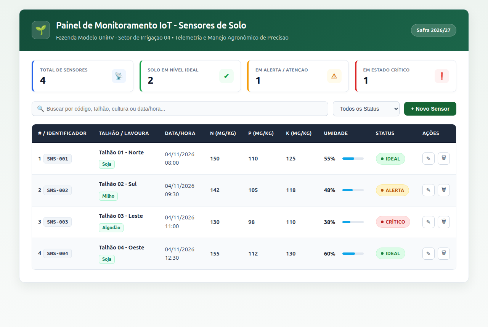

# AgroMonitor IoT — Monitoramento de Sensores de Solo (`agro-sensor-web`)

Aplicação Web Single Page Application (SPA) desenvolvida em **Angular** para o monitoramento em tempo real de leituras físico-químicas de sensores agrícolas de solo (Nitrogênio, Fósforo, Potássio e Umidade), referente à atividade prática da disciplina de **Desenvolvimento Web — Frameworks Front-End e Fundamentos do Angular** (UniRV).

---

## 1. Identificação do Aluno

- **Nome completo:** Felipe Martins de Almeida
- **Matrícula UniRV:** 

---

## 2. Descrição do Projeto

O **AgroMonitor IoT** (`agro-sensor-web`) apresenta o **Painel de Monitoramento IoT - Sensores de Solo** da **Fazenda Modelo UniRV - Setor de Irrigação 04**. Seu objetivo é fornecer uma interface reativa, tipada e responsiva para visualização e gerenciamento de métricas coletadas em lavouras:

- **Indicadores Rápidos (KPIs):** Contagem automática do total de sensores monitorados e distribuição por status operacional (*Ideal*, *Alerta* e *Crítico*).
- **Tabela Semântica de Telemetria:** Exibição estruturada de Identificador, Talhão/Cultura, Data/Hora da coleta, teores nutricionais de **N (mg/kg)**, **P (mg/kg)** e **K (mg/kg)**, **Umidade do Solo (%)** convertida a partir de valores decimais e distintivos visuais coloridos (*badges*) de **Status Operacional**.
- **Busca e Filtragem:** Pesquisa instantânea por código do sensor, talhão, cultura agrícola ou data/hora, além de filtro rápido por status operacional.
- **Gerenciamento de Sensores (CRUD):** Cadastro de novas leituras e alteração/exclusão de registros existentes por meio de modal interativo com cálculo automático de status operacional.

---

## 3. Tecnologias Utilizadas

- **Angular 18** (`@angular/core`, `@angular/common`, `@angular/forms`, `@angular/router`)
- **Angular CLI** (`@angular/cli`)
- **TypeScript 5.5**
- **HTML5 Semântico**
- **CSS3 Responsivo** (Flexbox, CSS Grid, Custom Badges, Zebra Table)
- **Karma + Jasmine** (Testes unitários automatizados)

---

## 4. Instalação

1. Clone o repositório:

```bash
git clone https://github.com/FelipeMrsAL/Atividade-Angular.git
cd Atividade-Angular
```

2. Instale as dependências do projeto:

```bash
npm install
```

---

## 5. Inicialização

Para iniciar o servidor de desenvolvimento local, execute:

```bash
ng serve
```

> Caso prefira executar via script do `npm`, também é possível utilizar `npm start`.

Após a compilação, acesse a aplicação no navegador em:

**[http://localhost:4200](http://localhost:4200)**

---

## 6. Captura de Tela da Aplicação

Captura de tela real da aplicação **AgroMonitor IoT** renderizada no navegador em `http://localhost:4200`:


