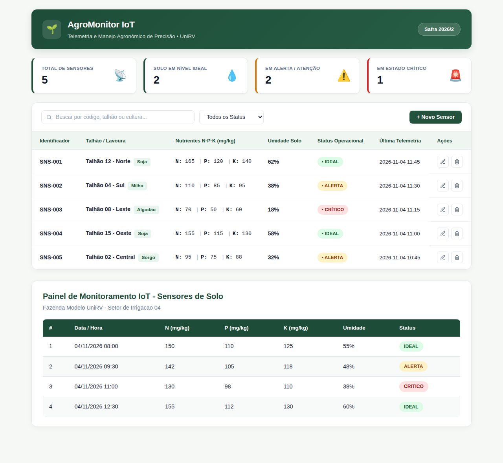

# AgroMonitor IoT — Monitoramento de Sensores de Solo (`agro-sensor-web`)

Aplicação Web Single Page Application (SPA) desenvolvida em **Angular** (arquitetura modular com `AppModule` e TypeScript) para a visualização e gerenciamento de leituras físico-químicas de sensores agrícolas de solo, referente à atividade prática da disciplina **Desenvolvimento Web — Frameworks Front-End e Fundamentos do Angular** (Prof. Me. Sergio Souza Novak — UniRV).

---

## 1. Identificação do Aluno

- **Nome completo:** Felipe Martins de Almeida
- **Matrícula UniRV:** 

---

## 2. Descrição do Projeto

O projeto implementa integralmente:

1. **Protótipo de Referência AgroMonitor IoT (Figuras 1, 2 e 3 do documento):**
   - Cabeçalho institucional **AgroMonitor IoT** (*Telemetria e Manejo Agronômico de Precisão • UniRV* | *Safra 2026/2*).
   - Cards de indicadores rápidos (**KPIs**): *Total de Sensores (5)*, *Solo em Nível Ideal (2)*, *Em Alerta / Atenção (2)* e *Em Estado Crítico (1)*.
   - Barra de busca instantânea por código, talhão ou cultura, filtro dropdown por status operacional e botão **+ Novo Sensor**.
   - Tabela de telemetria com as colunas **Identificador**, **Talhão / Lavoura**, **Nutrientes N-P-K (mg/kg)**, **Umidade Solo**, **Status Operacional**, **Última Telemetria** e **Ações** (edição e exclusão) com os sensores `SNS-001` a `SNS-005`.
   - Modais **Cadastrar Novo Sensor IoT** (Figura 2) e **Alterar Dados do Sensor** (Figura 3).

2. **Componente e Tabela Passo a Passo (Etapas 1 a 6 do enunciado):**
   - Interface `LeituraSolo` em `src/app/interfaces/sensores.interface.ts`.
   - Componente `ContainerTabelaComponent` (`app-container-tabela`) declarado no `AppModule` (`src/app/app.module.ts`).
   - Cabeçalho interpolado (`{{ titulo }}` e `{{ fazenda }}`) e tabela semântica `.tabela-sensores` com as 7 colunas exigidas (`#`, `Data / Hora`, `N (mg/kg)`, `P (mg/kg)`, `K (mg/kg)`, `Umidade`, `Status`), exibindo as 4 leituras de teste obrigatórias com cabeçalho escuro, efeito zebra e *badges* coloridos.

---

## 3. Tecnologias Utilizadas

- **Angular 18** (`@angular/core`, `@angular/common`, `@angular/forms`, `@angular/platform-browser`, `@angular/router`)
- **Angular CLI** (`@angular/cli`)
- **TypeScript 5.5**
- **HTML5 Semântico e CSS3 Responsivo**
- **Karma + Jasmine** (Testes unitários)

---

## 4. Instruções de Instalação e Inicialização

Você pode executar o projeto diretamente na raiz do repositório ou dentro da pasta `agro-sensor-web/`:

```bash
# 1. Clonar o repositório
git clone https://github.com/FelipeMrsAL/Atividade-Angular.git
cd Atividade-Angular

# (Opcional, conforme Etapa 1 do roteiro)
cd agro-sensor-web

# 2. Instalar as dependências
npm install

# 3. Iniciar o servidor local de desenvolvimento
ng serve
```

A aplicação estará disponível no navegador em:

**[http://localhost:4200](http://localhost:4200)**

---

## 5. Captura de Tela da Aplicação (`http://localhost:4200`)


